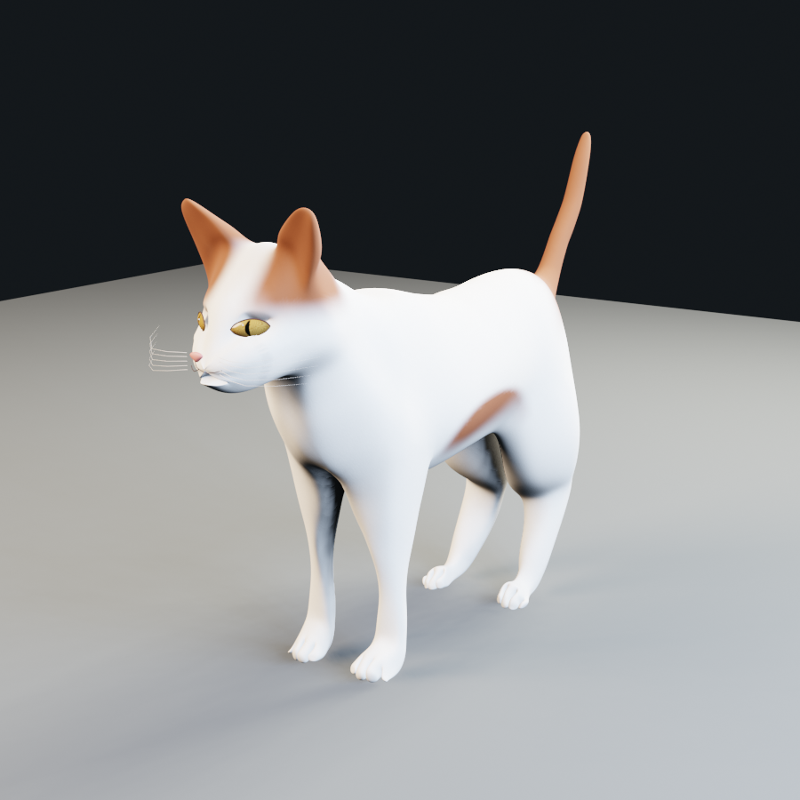

# Mega Chonk

Mega Chonk is a third-person 3D browser game about a Turkish Van balancing hunger, weight, and agility across a large house. Its cat is a real skinned 3D character, rendered by the locally bundled Three.js engine, with approximately 193,000 triangles and seven skeletal animation clips.

## Play Online

**[Play Mega Chonk](https://desmondttm123.github.io/MegaChonk/)**

Open the link in a modern desktop browser with WebGL 2 enabled. No installation, Blender, Python, or GitHub account is required to play. Click **Enter the house** to capture the mouse; press `Esc` to release it. The first load downloads a roughly 10 MB cat model. Keyboard and mouse are required; touch controls are not implemented.



## Run Locally

Double-click `start-game.bat` and keep the terminal window open while playing. Alternatively, run:

```powershell
python -m http.server 4173 --bind 127.0.0.1
```

Then open `http://127.0.0.1:4173`.

For local development, keep the server running; opening `index.html` directly will not load JavaScript modules reliably. The hosted version needs no local server.

## Contributor Handoff

Read [AGENTS.md](AGENTS.md) for repository instructions, [MEMORY.md](MEMORY.md) for the current state and where work stopped, and [CONTRIBUTING.md](CONTRIBUTING.md) for setup, tests, and release steps. Contributors should update the memory after meaningful changes so the next person or coding agent can continue without the original chat.

Artists can improve the playable cat in Blender. Start with the [artist cat guide](docs/artist-cat-guide.md), covering the active source file, sculpting/rigging, materials, all seven animations, GLB export, and the review handoff. A beauty render alone does not replace the in-game character.

## Deployment

The [Deploy Mega Chonk workflow](https://github.com/desmondttm123/MegaChonk/actions/workflows/pages.yml) deploys pushes to `main` automatically using GitHub Pages. It can also be started manually from the Actions tab. Pages must use **GitHub Actions** as its deployment source in the repository settings.

`python tools/build_pages.py` creates a runtime-only `dist/` directory, following the game's JavaScript imports and including the cat GLB and required licenses. It excludes Blender projects, printable models, source FBX files, old sprites, test tools, and unused Three.js modules. The editable Blender project remains available in this repository, not in the deployed site.

The build preserves relative URLs so modules and models work under `/MegaChonk/`. A `build-manifest.json` records the deployed revision and asset hashes. No backend, database, or build-time Blender installation is needed.

## Controls

- `WASD` or arrow keys: camera-relative movement
- `Shift`: trot
- Mouse: orbit camera
- `Space`: jump
- `Q`: sit or stand
- `F` or left mouse: claw
- `E` or right mouse: bite
- Click: recapture camera
- `Esc`: release pointer lock

Mouse look uses filtered relative input, frame-independent smoothing, and bounded turn speed. Cursor-warp samples on capture/focus changes are discarded; leaving the game window clears queued motion. The camera eases outward after clearing furniture rather than snapping to full follow distance.

## Core Loop

Find every bowl in a room, then reach the glowing pet door. Complete Living Room Zoomies, Kitchen Counter Caper, and Attic Midnight Run to finish a run.

- Movement accelerates and decelerates instead of starting or stopping instantly.
- The cat smoothly turns toward camera-relative movement.
- Eating restores satiety quickly and adds chonk; movement drains both very slowly.
- Stop beside a bowl to eat automatically. Moving away interrupts eating immediately.
- The cat is fastest near balanced satiety and slows when hungry, overfull, or heavy.
- A starving cat cannot leap, while a cat at maximum chonk must exercise before jumping again.
- Extra weight progressively shortens jumps without making a normal run unwinnable.
- Every room has an oak staircase and an upstairs gallery at 2.7 game units, with one required meal upstairs. Walk onto the stairs; repeated jumping is not needed.
- The green catnip bowl upstairs grants 18 seconds of +32% speed and +18% jump impulse. Use `Shift` + `Space` from the marked balcony opening to reach the bonus perch, then descend the shelves.
- Catnip returns after 22 seconds. It has no chonk cost and does not bypass starving/heavy jump restrictions. Catnip and the bonus treat are optional, not requirements for opening the pet door.
- After five seconds without input, the cat transitions into its grooming animation.
- Sofas, counters, storage boxes, cushions, spills, robot vacuums, raised ottomans, moving footstools, and cat-bed checkpoints form the obstacle courses.
- The house has a 46 x 42-unit footprint, nearly twice the previous floor area, and the cat is 37% smaller. The camera, collision capsule, bowls, and shadow match the corrected proportions.
- Each run seed generates hurdle dimensions, spill/bridge locations, vacuum positions and phases, and mixed household clutter: 25, 30, and 37 generated obstacles across the three rooms. Food locations also vary within safe zones.
- A grid route planner reserves clear corridors to bowls, stairs, checkpoints, and pet doors before placing obstacles. Moving-platform travel and rotating-vacuum reach are included in placement clearance. The structural upstairs route stays fixed so its catnip jump remains reliable.
- The cat is visible from any angle with interpolated bone animation and smooth transitions between actions.
- Foot targets guide the walk cycle and seated poses; the idle clip includes breathing, blinking, head turns, ear movement, and tail sway. Forelegs have higher anatomical elbows, articulated scapulae, and smoothed joint weights.
- Fur uses white/chestnut vertex colors, subtle surface detail, and a soft sheen. Larger inset eyes have round, almost-black night pupils, thin amber iris edges, and animated eyelids. This is an improved game prototype rather than a production AAA animal asset.

## Main Assets

- `assets/models/turkish-van-game-cat.glb`: runtime skinned Turkish Van and all seven animations
- `assets/models/turkish-van-game-cat.blend`: editable model, materials, skeleton, and animation source
- `tools/generate_stray_style_cat.py`: reproducible Blender preparation and export pipeline
- `assets/models/game-cat-previews/`: Blender inspection renders
- `assets/models/source/jonas-dichelle-cat/ATTRIBUTION.md`: base mesh source and license
- `assets/models/sitting-turkish-van-cat.stl`: separate printable sitting model
- `vendor/three`: locally bundled Three.js 0.186.0 runtime

The base mesh is derived from Jonas Dichelle's [Rigged and animated Cat](https://blendswap.com/blend/18519), licensed under [CC BY 3.0](https://creativecommons.org/licenses/by/3.0/). Mega Chonk adds a new skeleton, skin weights, animations, facial details, Turkish Van coat, and game materials. No Stray assets are included.

Regenerate with Blender 3.4 in the project directory:

```powershell
& 'C:\Program Files\Blender Foundation\Blender 3.4\blender.exe' --background --factory-startup --python-exit-code 1 --python tools/generate_stray_style_cat.py
```

This runs in a separate process and does not alter an open Blender scene.

## Verification

`tools/smoke-test.js` checks skinned mesh loading, exported coat colors, all action states, movement orientation, grooming interruption, satiety drain, jump limits, house systems, and screenshots.

`tools/visual-cat-test.js` captures four viewing angles and several animation poses, checks night-pupil colors and eye aperture size, samples deformed geometry for floor penetration, and reports frame timing.

`tools/generation-test.js` checks 90 seeded layouts across all three rooms for reproducibility, obstacle counts, overlapping obstacles, protected corridors, and routes through the actual collision/hazard geometry to every ground-floor objective and the stairs.

`tools/camera-controls-test.js [URL]` checks small/native mouse movements, invalid deltas, event bursts, focus recovery, repeated pointer-lock capture/release, 30/60/144 FPS input consistency, and camera recovery at a furniture corner. Omit the URL for the local game or pass the live URL to verify deployment.

`tools/vertical-challenges-test.js` walks up and down stairs in all three rooms, compares normal and catnip-assisted long jumps, checks boost expiry and hunger/weight limits, and tests the gallery underside collision.

`tools/pages-test.js` tests the runtime-only build mounted under `/MegaChonk/`. Pass the live URL to test the hosted version; it checks asset hashes, attribution, level generation, movement, jumping, and browser errors.

`tools/autoplay-test.js [seed]` drives the game with keyboard controls through every meal and pet door on all three levels. It fails on an unreachable objective, broken transition, browser error, or incorrect final score. The browser tests require Node.js, Playwright, Microsoft Edge, and Python on PATH.
